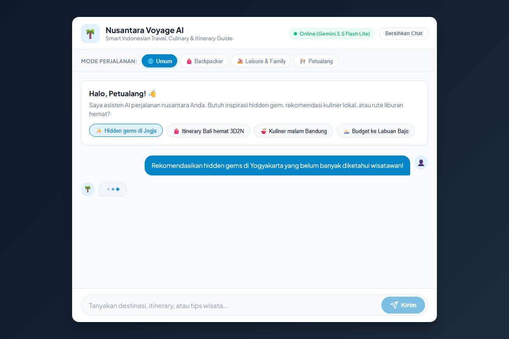

# 🌴 Nusantara Voyage AI — Indonesian Travel Assistant

> **Proyek Akhir Sesi 3 — Hacktiv8: AI Productivity and AI API Integration for Developers**  
> *Program AI Opportunity Fund: Asia Pacific (AVPN x Google.org x ADB x Hacktiv8)*

---

## 📌 Deskripsi Proyek & Use Case



**Nusantara Voyage AI** adalah aplikasi web chatbot cerdas berbasis Large Language Model (**Google Gemini 3.5 Flash Lite**) yang dirancang khusus sebagai asisten pemandu wisata, rekomendasi kuliner lokal, perencana *itinerary*, dan kalkulator estimasi *budget* perjalanan di seluruh pelosok Indonesia.

### ✨ Fitur Utama
1. **Multi-Turn Conversation Memory**: Menyimpan riwayat percakapan antara pengguna dan AI sehingga asisten memahami konteks sebelumnya (misal: tanya destinasi lalu lanjut tanya rekomendasi hotel di tempat tersebut).
2. **Kustomisasi Parameter & Persona (Tone Selector)**:
   - 🌐 **Umum (General)**: Panduan seimbang, informatif, dan santai (*Temperature: 0.7*).
   - 🎒 **Backpacker**: Fokus pada efisiensi biaya, transportasi umum termurah, hostel, dan kuliner kaki lima (*Temperature: 0.5*).
   - 🏖️ **Leisure & Family**: Rute santai, destinasi ramah anak & lansia, serta kenyamanan maksimal (*Temperature: 0.7*).
   - 🧗 **Petualang (Adventure)**: Eksplorasi alam terbuka, hidden gems, hiking, diving, dan tips keselamatan outdoor (*Temperature: 0.9*).
3. **Penyempurnaan Parameter AI**: Konfigurasi parameter `temperature`, `top_p`, `top_k`, dan `systemInstruction` via SDK resmi `@google/genai`.
4. **Antarmuka Interaktif & Responsif**:
   - Vanilla JS tanpa framework tambahan (ringan & cepat).
   - Indikator respons real-time (*AI thinking animation*).
   - Quick Suggestion Chips untuk ide pertanyaan cepat.
   - Rich Markdown formatting (bullet points, bold text, inline code).
   - Tombol *Reset / Bersihkan Chat*.

---

## 🏗️ Arsitektur & Struktur Proyek

Aplikasi dibangun dengan arsitektur full-stack sederhana dan modular:

```text
├── Static/
│   ├── index.html        # Antarmuka web pengguna (UI Chat)
│   ├── style.css         # Styling modern & responsif (Plus Jakarta Sans)
│   └── script.js         # Logika frontend, fetch API, DOM, dan state memori
├── .env                  # Kredensial lokal (diabaikan oleh git)
├── .env.example          # Contoh format environment variables
├── .gitignore            # Konfigurasi pengecualian file rahasia & dependencies
├── index.js              # Server Express.js, routing, dan integrasi Gemini AI SDK
├── package.json          # Metadata proyek, dependencies, dan npm scripts
└── README.md             # Dokumentasi lengkap proyek
```

---

## 🚀 Panduan Instalasi & Menjalankan Aplikasi

### 1. Prasyarat
- **Node.js** v18+ (direkomendasikan v20+)
- **Gemini API Key** dari [Google AI Studio](https://aistudio.google.com/)

### 2. Kloning Repositori & Instalasi Dependensi
```bash
git clone https://github.com/<your-username>/<your-repo-name>.git
cd <your-repo-name>
npm install
```

### 3. Konfigurasi Environment Variables
Salin file `.env.example` menjadi `.env` dan masukkan API Key Anda:
```env
GEMINI_API_KEY=your_gemini_api_key_here
GEMINI_MODEL=gemini-3.5-flash-lite
PORT=4848
```

### 4. Menjalankan Server
```bash
# Menjalankan server produksi
npm start

# Atau mode development (auto-reload)
npm run dev
```

Buka browser dan akses antarmuka chatbot di:
👉 **`http://localhost:4848`**

---

## 📡 Dokumentasi Endpoint Backend

### `POST /api/chat`
Endpoint utama untuk percakapan interaktif multi-turn.

- **Request Body (JSON):**
  ```json
  {
    "conversation": [
      { "role": "user", "text": "Halo, saya ingin liburan ke Jogja 3 hari!" }
    ],
    "tone": "backpacker",
    "temperature": 0.5
  }
  ```
- **Response (JSON):**
  ```json
  {
    "result": "Halo! Untuk trip backpacker ke Jogja 3 hari, ini rekomendasi rute hematnya...",
    "model": "gemini-3.5-flash-lite",
    "meta": {
      "tone": "backpacker",
      "temperature": 0.5
    }
  }
  ```

---

## 👨‍💻 Kontributor
- **Nama Peserta**: Asia Kamil
- **Program**: AI Productivity & AI API Integration for Developers — Hacktiv8

